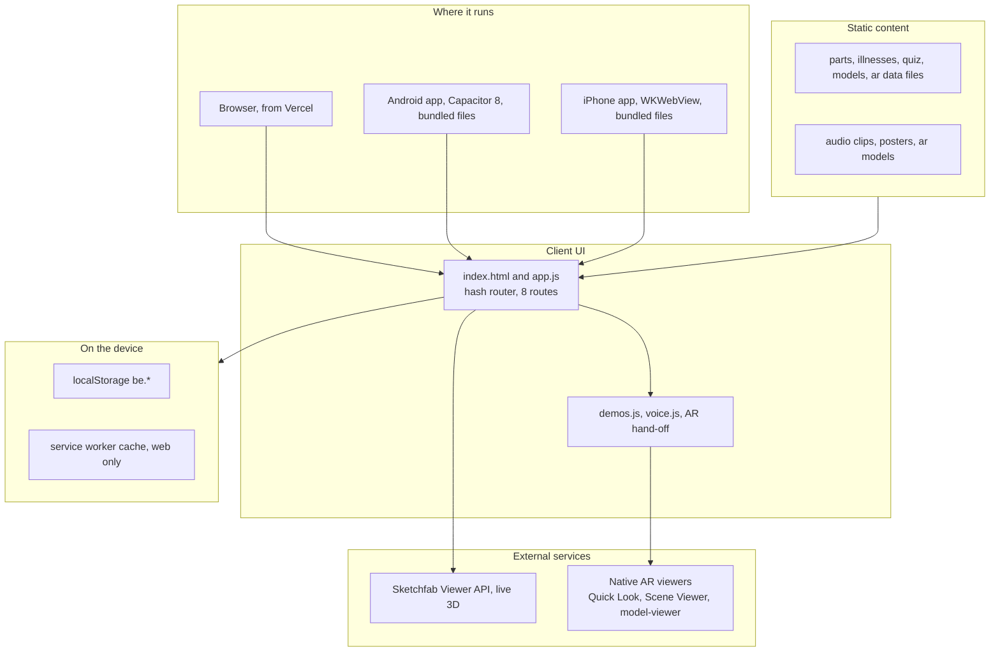
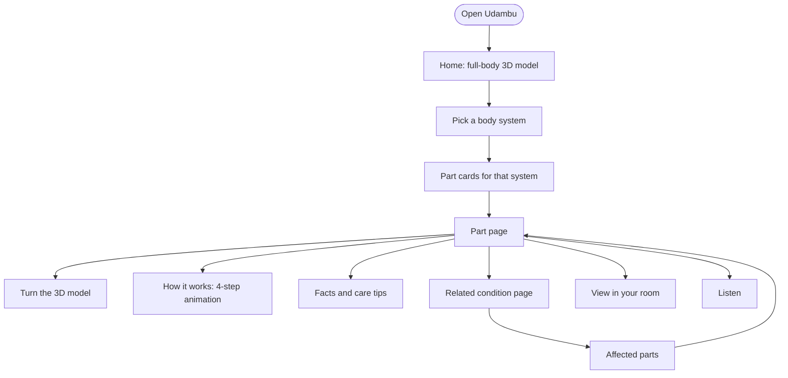
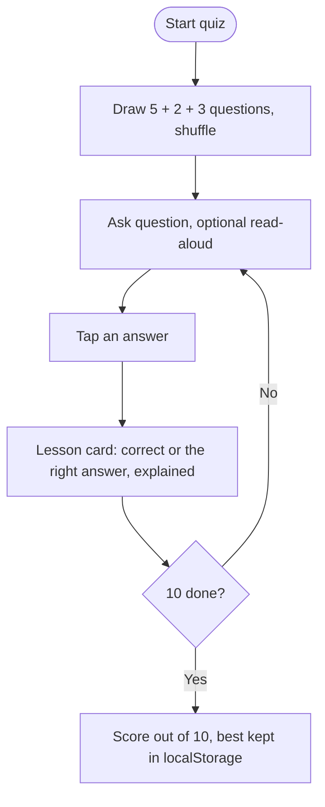
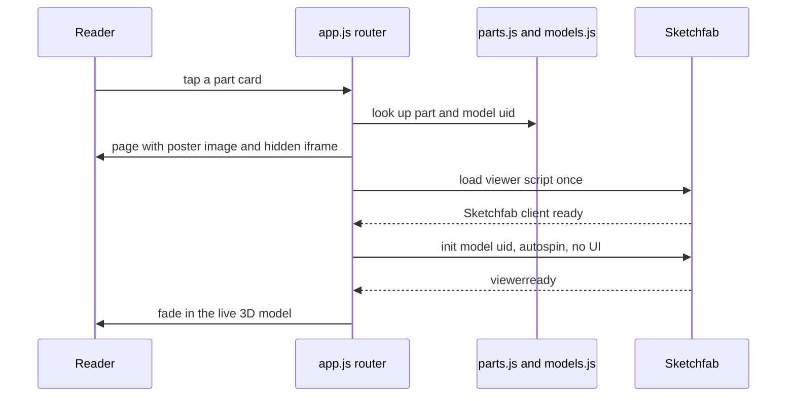
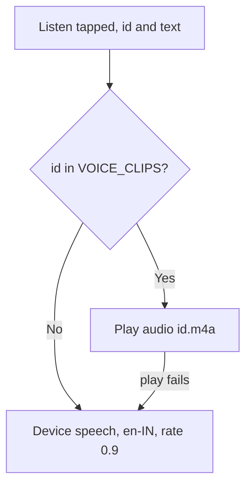
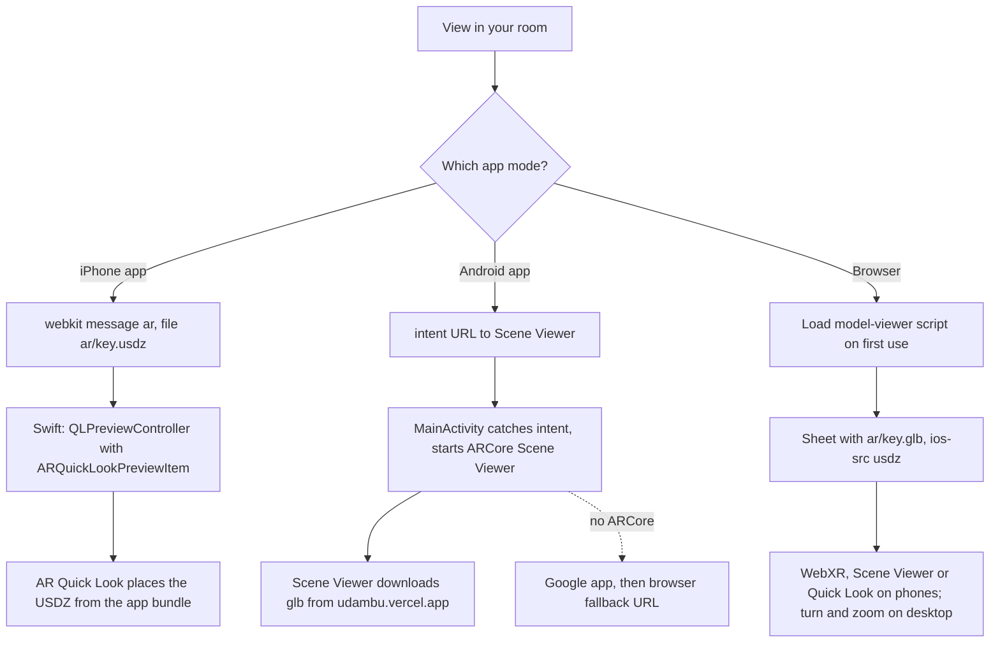
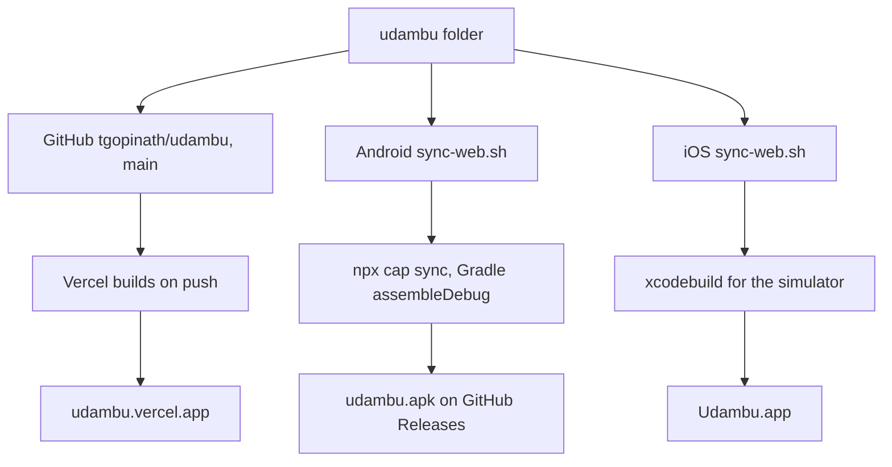
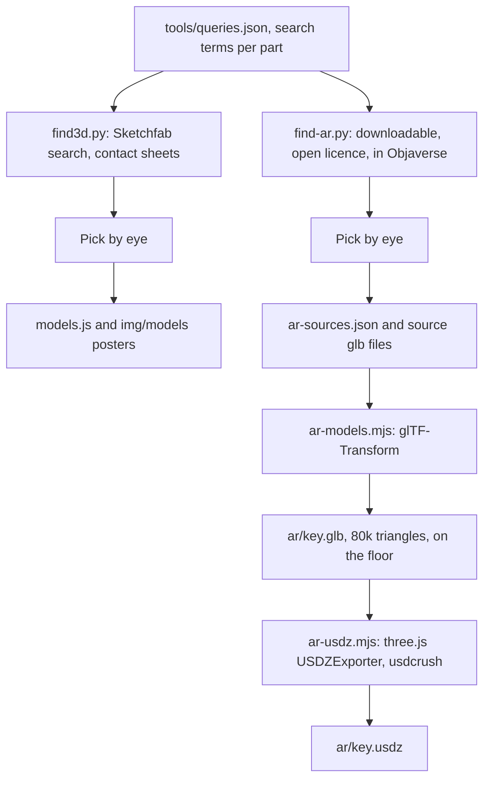
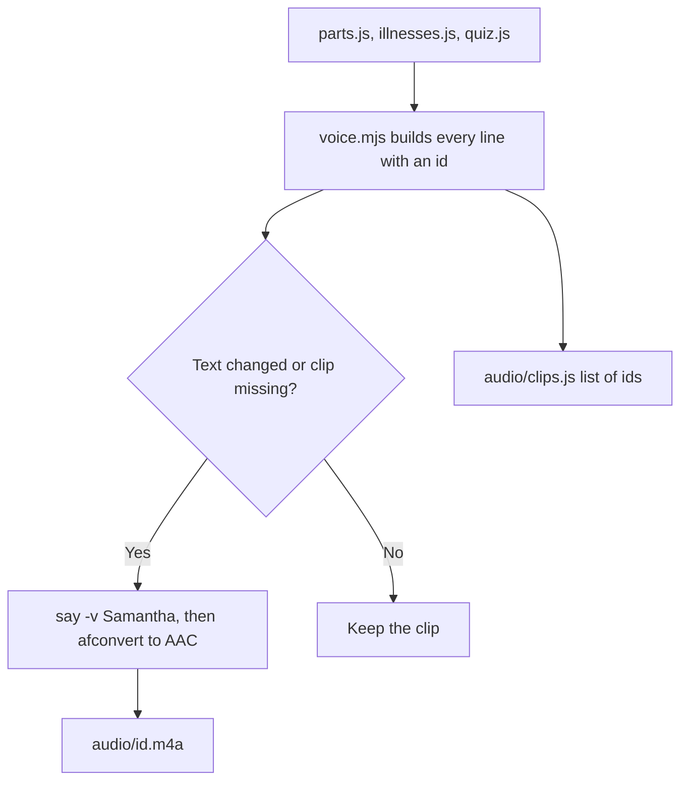

# Udambu (உடம்பு): architecture

Udambu is a human-body atlas for adults. Each body part has a real 3D model you can turn, a plain-English summary and a fuller anatomy text, key figures, a four-step animation of how it works, facts, care tips and related conditions. There is also a library of common conditions, a teaching quiz, read-aloud for every line, and "View in your room" augmented reality. The main engineering idea: a static app with no build step and no backend. All content lives in plain JavaScript data files, and the heavy work (choosing 3D models, converting them for AR, recording the voice) is done once, offline, by scripts in `tools/`.

| Platforms | Stack | Data | Hosting |
| --- | --- | --- | --- |
| Web PWA, Android app (Capacitor, bundled), iPhone app (SwiftUI WKWebView, bundled) | Vanilla JS, no framework or bundler, Kolam CSS, Sketchfab Viewer API, model-viewer | Static JS data files; small preferences in localStorage; no server, no accounts | Vercel static site (git-connected), APK on GitHub Releases |

## System architecture

One `index.html` loads the data files and then `app.js` as ordinary scripts, in order. `app.js` is a small hash router that draws each page into `<main id="app">`. The 3D models are not stored in the app: each one is a Sketchfab embed, driven through Sketchfab's Viewer API. The AR models are the exception: they are prepared files in `ar/`, because AR viewers need a local or downloadable file.

The same web files run in three places. In a browser they keep the Kolam design system. Inside the Android app the Kolam M3 kit switches on Material Design 3, and inside the iPhone app the Kolam iOS kit switches on the Apple HIG look. Both phone apps carry a copy of the web files.

*Everything is static. The only network calls are to Sketchfab for the live 3D, and, on Android AR, from Google's Scene Viewer back to the published site.*

## Main user flow

The core job is: pick a body system, open a part, and understand it. From any part you can go to its conditions, play its animation, hear it read aloud, or place it on the floor in AR.

*The bottom tabs (Body, Parts, Health, Quiz) are the four roots. Part and condition pages are deep pages with a Back button.*

### Quiz flow

The Body quiz picks 10 questions from `quiz.js`: 5 "which part does this", 2 "name the part in the picture" and 3 health-literacy questions with text answers. After every answer a lesson card explains the answer, with the part's picture, a "Turn in 3D" button, Learn more and, when the part has one, AR. A second game, "What does this?", shows a part's animation and asks you to pick the part.

## Data flow and state

A part page shows a still poster image (`img/models/<key>.jpg`) at once. The Sketchfab script is loaded only once, the first time a page has a model. The iframe sits on top of the poster and is faded in only when Sketchfab fires `viewerready`, so the reader never sees a loading screen. If the Viewer API fails, the iframe falls back to the plain embed URL and shows after four seconds.

*mountSketchfab in app.js. Screenshot runs with a shot= query skip the live model and keep the poster.*

### Read-aloud

Every readable line has a stable id such as `heart-say` or `quiz-ok-12`. If the id is in `audio/clips.js`, the recorded clip plays, so the voice sounds the same on every phone. Otherwise the device's own speech synthesis reads the text. Tapping the same button again stops it. Pages do not read themselves aloud unless the reader turns auto read-aloud on; Listen buttons always work.

| Where | Key | What it holds |
| --- | --- | --- |
| localStorage | `be.muted` | Auto read-aloud off or on (off by default) |
| localStorage | `be.homeSys` | Body system last chosen on Home |
| localStorage | `be.sickFilter` | Conditions filter: all, infections, inside the body, injuries |
| localStorage | `be.best` | Best score per game (`quiz`, `which`) |
| sessionStorage | `k-app-mode`, `kolam.app` | Forced app look from `?app=android`, `?app=ios` or `?app=web` (set by the Kolam kits) |
| Cache Storage | `udambu-v4-ios` | Service worker cache of same-origin GET responses (website only) |
| Static files | JS data, `audio/`, `img/`, `ar/` | All content. Nothing is written to a server. |

## Key modules

| File / module | Responsibility |
| --- | --- |
| `index.html` | Top bar, `<main id="app">`, bottom tab bar; loads the kits, the data files and `app.js` in order. Forces the dark theme. |
| `app.js` | App-mode detection, icons, hash router (8 routes), every page, Sketchfab mounting, AR, quiz games, simple Web Audio tones, Android Back handling, service worker registration. |
| `parts.js` | 11 body systems and the parts. Each part has name, anatomical term, system, location, key figures, summary, fuller text, four "how" steps, facts, care tips, related conditions and its demo. |
| `illnesses.js` | 49 conditions (19 infections, 25 conditions of the body, 5 injuries) with overview, cause, symptoms, diagnosis and treatment, prevention, when to see a doctor, and the parts affected. |
| `quiz.js` | 86 questions: 46 pick-the-part, 18 name-the-picture, 22 health-literacy questions with an explanation each. |
| `models.js` | Sketchfab model per part (uid, title, author, licence). `body` is the full-body model on Home. |
| `ar.js` | The 42 AR-ready models (41 parts plus the Home skeleton) with credits. |
| `demos.js` | 31 SVG animations using SMIL. Each loops for 8 seconds in four 2-second steps that match the part's four "how" captions. |
| `voice.js` + `audio/clips.js` | Plays recorded clips, falls back to device speech. |
| `sw.js`, `manifest.webmanifest` | Offline cache and install data for the website. |
| `vendor/` | Kolam tokens and CSS, Kolam M3 kit, Kolam iOS kit, model-viewer, Lato fonts (in `fonts/`). |
| `tools/` | Offline scripts: model search, AR conversion, voice recording, icons, screenshots. Not shipped. |

The part page uses `demoSVG(p.demo)` and reads the SVG clock with `getCurrentTime()` on every animation frame to show which of the four steps is playing. Step buttons jump with `setCurrentTime()`, and pause uses `pauseAnimations()`. Because it is plain SVG with SMIL, it runs the same in browsers, Android WebView and iOS WKWebView.

### Augmented reality per platform

"View in your room" is offered only for parts listed in `ar.js`. Each platform uses its own native AR viewer, so the app has no AR code of its own beyond the hand-off.

*The Android app does not ship the AR files; Scene Viewer fetches the published copy. The iPhone app ships only the USDZ files; the website serves both.*

## Platforms

| Platform | How it is built | Look |
| --- | --- | --- |
| Web / PWA | Static files on Vercel. Service worker registered only on https and outside the phone apps. | Kolam design system, dark anatomy theme, Lato. |
| Android | Capacitor 8 shell in `android-wrappers/udambu`, app id `com.gopinath.udambu`, min SDK 24, target SDK 36. **Bundled**: `sync-web.sh` copies the web files into `www/` (without `ar/`, `tools/`, `sw.js`) and builds a debug APK. The WebView user agent gets `Udambu-Android`. A custom `BridgeWebViewClient` in `MainActivity` turns `intent://` links into Android intents for Scene Viewer. | Material Design 3 from the Kolam M3 kit (`html.k-android`): app bar, navigation bar with four destinations, Back, M3 colours from `#0a8fc7`. The kit hides the web top bar and tab bar. |
| iPhone | SwiftUI app in `Udambu-iOS` (iOS 17+) with a WKWebView that loads the bundled `web/` folder from the file system. `sync-web.sh` copies the web files (without `*.glb`) and builds for the simulator. It injects `window.KolamShell`, sets the UA token `Udambu-iOS`, handles `haptic` and `ar` messages, opens outside links in Safari's in-app viewer, and plays voice even with the silent switch on. | Apple HIG from the Kolam iOS kit (`html.k-ios`): large titles, Liquid Glass tab bar, back button with centred title, haptics. |

How the look is chosen: both kit scripts run in `<head>` before first paint. The M3 kit adds `k-android` in the Capacitor Android app, an Android WebView or an installed Android PWA. The iOS kit adds `k-ios` when it sees the shell. `app.js` then adds `app` plus `ios` or `android`, and iOS wins if both match. In any ordinary browser neither kit changes anything. `?app=android`, `?app=ios` and `?app=web` force a look for testing.

## Data sources and APIs

| Source | Used for | Licence / key |
| --- | --- | --- |
| Sketchfab Viewer API 1.12.1 | The live 3D model on Home, every part page and quiz lessons | No key. Each model is shown in Sketchfab's own player with its author and licence credited on the page. Licences vary per model (CC Attribution, Standard, Editorial and others, listed in `models.js`). |
| Sketchfab search API | Finding candidate models offline (`tools/find3d.py`, `tools/find-ar.py`) | No key, used only by the tools |
| Objaverse mirror of Sketchfab models | Source files for the AR models | Only openly licensed downloadable models; the 42 chosen are 41 CC Attribution and 1 CC Attribution-ShareAlike, credited in the AR sheet |
| Google Scene Viewer (ARCore) | AR in the Android app | No key; needs Google Play Services for AR or the Google app |
| Apple AR Quick Look | AR in the iPhone app and iPhone Safari | Built into iOS |
| model-viewer (vendored) | The web AR sheet | Apache 2.0, loaded only when needed |
| macOS voice "Samantha" | Recorded read-aloud clips | Generated locally with `say` and `afconvert` |
| WHO and NHS guidance | Basis for the health-literacy quiz and condition text | Written as general information, not medical advice |

## Offline, performance, privacy and accessibility

**Offline.** On the website a service worker serves from cache first and refreshes the cache in the background (stale-while-revalidate) for same-origin GET requests. The phone apps carry their files, so text, pictures, animations and voice work offline. The live 3D needs the internet in every version; the poster image stays when it is offline. Android AR also needs the internet, because Scene Viewer downloads the model.

**Performance.** No framework and no bundler. The Sketchfab script loads once, only when a page has a model. model-viewer (about 1 MB) loads only when someone opens the AR sheet. Card images are lazy-loaded JPEG posters. AR models are cut to about 80,000 triangles and 1024 px textures (the 42 GLB files total about 63 MB, the USDZ files about 56 MB) and are downloaded only when used.

**Privacy.** No accounts, no analytics code in the app, no server. Preferences stay in the browser. Sketchfab embeds are set with `dnt: 1`. The only third parties are Sketchfab (3D) and, on Android AR, Google's Scene Viewer.

**Accessibility.** Every line can be heard. Icon buttons have labels; tabs use `role="tab"` and `aria-selected`; the current tab has `aria-current`; toasts use `aria-live`. The AR sheet is a labelled dialog that closes with Escape. The speaking animation stops under reduced motion. On iPhone the shell passes Reduce Transparency and Bold Text settings to the iOS kit. Not verified from code: full keyboard and screen-reader testing of the 3D iframes.

## Build and deploy

There is no build step for the website. A push to `main` on GitHub makes Vercel publish the folder as it is. The phone apps are rebuilt by hand with each shell's `sync-web.sh`. The Android APK is uploaded to the GitHub release so the portfolio's download link stays the same.

### Asset pipeline

The tools run on the developer's Mac. Nothing here runs in the app.

*ar-models.mjs drops unwanted nodes, converts old spec-gloss materials, welds and simplifies with meshoptimizer, turns opaque textures into 1024 px JPEG, and scales each model to a set height (0.6 m by default, 1.75 m for the skeleton) standing on the floor.*

*voice.mjs keeps a record of the last text per id in .work/voice.json, so only new or changed lines are recorded again, and deletes clips that no longer have a line.*

Other tools: `native-icons.py` renders `icon.svg` into the iPhone and Android icons and splash screens; `shots.mjs` and `snap.mjs` take headless Chrome screenshots for the portfolio.

## Known limits and next steps

- This document describes the code committed on `main`, which is what the live site serves: 49 parts in 11 systems and 50 Sketchfab models. Work in progress in the folder, not yet committed, adds more parts, splits the part page into tabs and adds a facts row to Home; this document will need a refresh when that lands.
- Voice clips cover the lines that existed when `voice.mjs` last ran; any new line falls back to device speech until it runs again. `clips.js` still lists a few lines from older games (for example the layer names) that the app no longer uses.
- 8 of the 49 parts have no AR model (no clean, openly licensed model was found, for example skin, tongue, muscles, spleen).
- Real AR has not been tested on a device from this code: the iOS Simulator has no ARKit and the arm64 Android emulator fails with ARCore.
- Android AR depends on the published site, because Scene Viewer downloads the GLB from `udambu.vercel.app`.
- The live 3D depends on Sketchfab being reachable; some model licences are Sketchfab Standard or Editorial, which allow viewing in the Sketchfab player but not downloading.
- The tools contain fixed paths from an older folder layout (`~/Documents/kanal`, `~/Documents/Udambu-iOS`); they need updating before the AR and icon scripts run again.
- The Android build is a debug APK (version 1.0); the iPhone app installs only on simulators or through TestFlight.
- `app.js` still contains an unused `confetti()` helper.

---

Written from the source code on 17 November 2026. Source: [github.com/tgopinath/udambu](https://github.com/tgopinath/udambu) (iPhone shell: github.com/tgopinath/Udambu-iOS)
