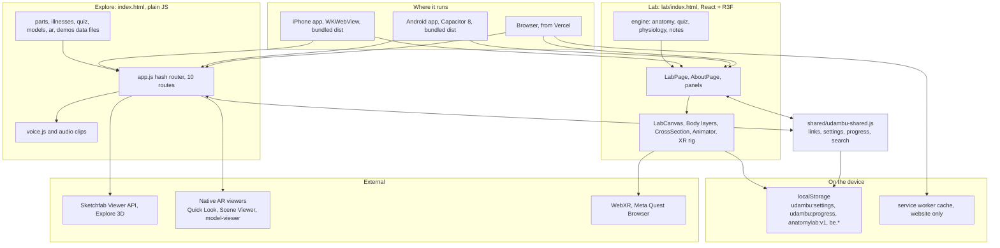
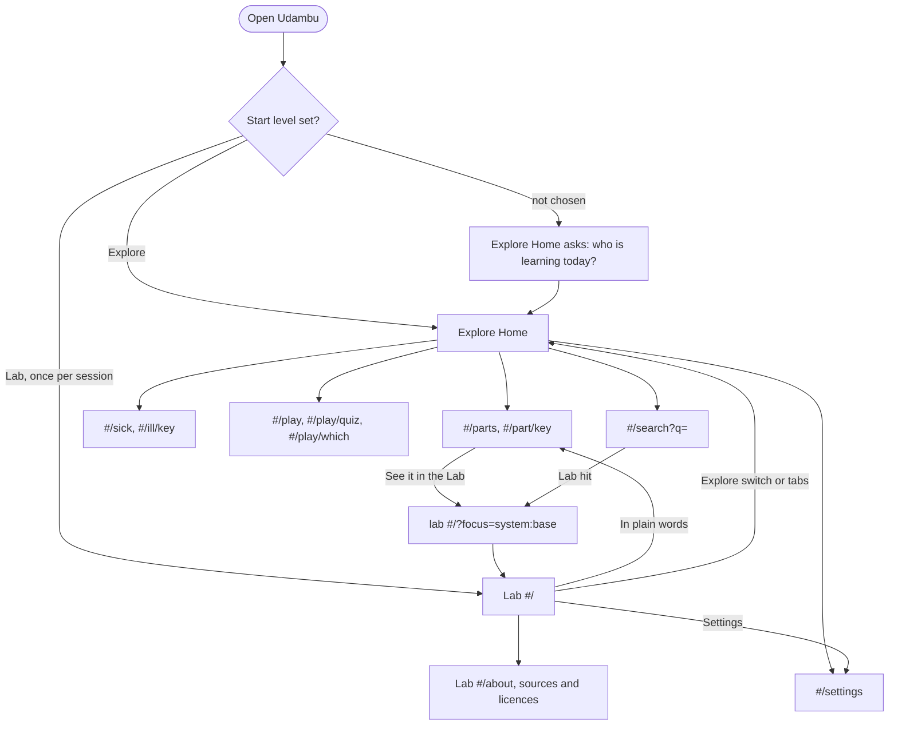
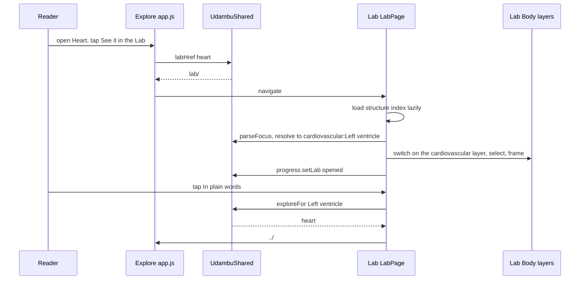
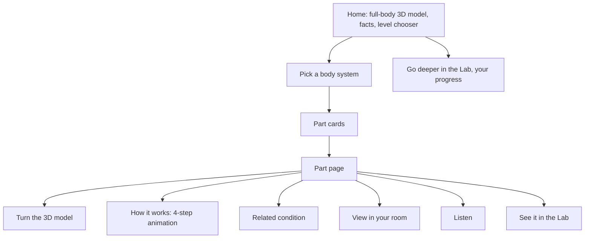
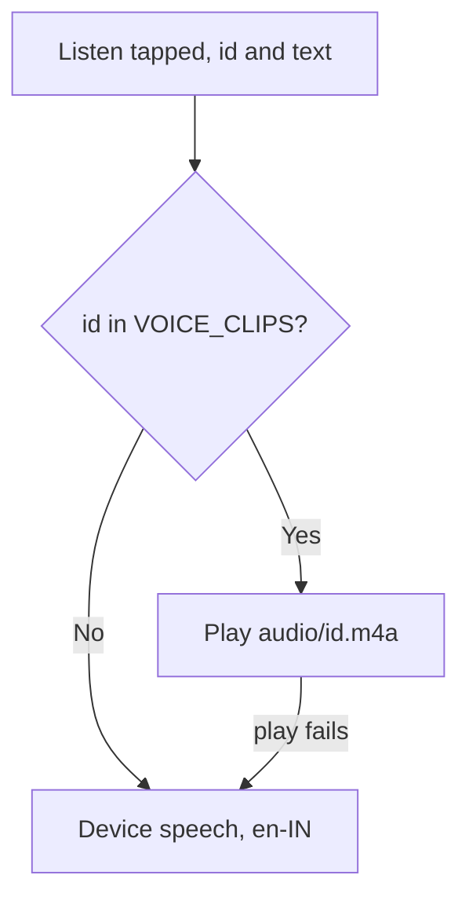
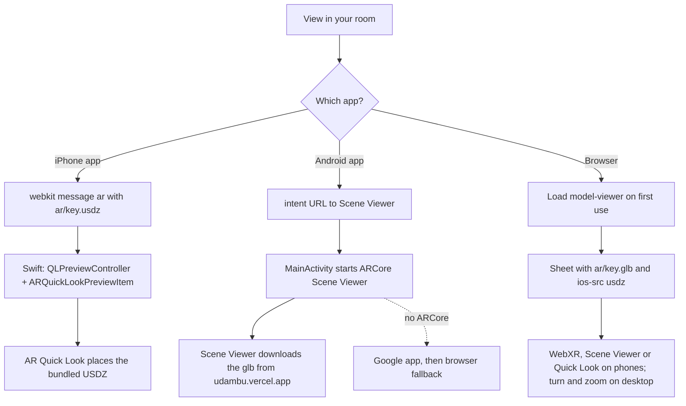
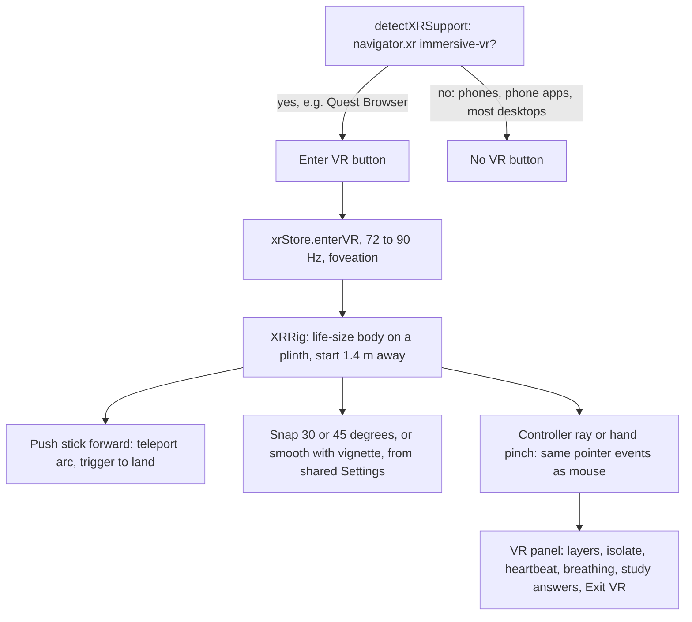
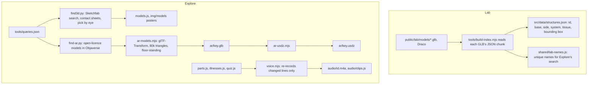
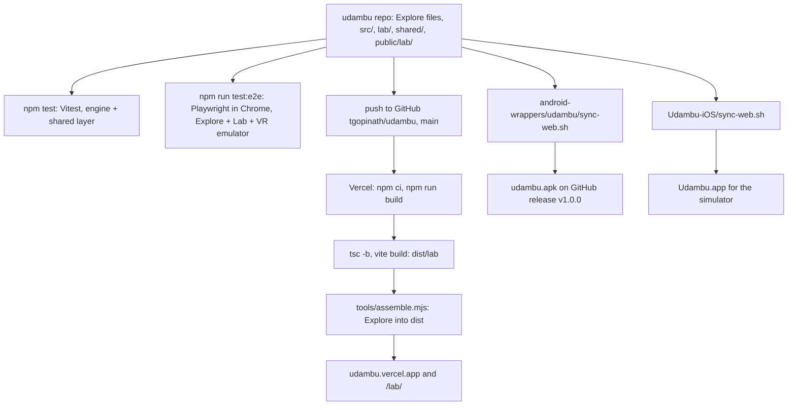

# Udambu (உடம்பு): architecture

Udambu ("body" in Tamil) explains the human body at two levels in one app:

- **Explore**: the body in plain words for everyone, from about age 5 with a grown-up. 63 parts in 11 systems, each with a real 3D model you can turn, a four-step "how it works" animation, key figures, facts, care tips and related conditions; 49 common conditions; a teaching quiz; every line read aloud; "View in your room" augmented reality on every platform.
- **Lab**: the student level. A 3D and VR anatomy atlas of 2,827 named structures from open data (BodyParts3D and Z-Anatomy): seven body-system layers loaded on demand, opacity, cross-sections, isolate and hide, build-your-own body, heartbeat and breathing on the real meshes, spaced-repetition study cards, and life-size WebXR on Meta Quest.

Both levels share one home, one top-level switch (Explore | Lab), one tab bar, one settings screen, one progress store, one search, and links both ways: an Explore part page has "See it in the Lab", and a Lab structure has "In plain words" back to Explore.

| Platforms | Stack | Data | Hosting |
| --- | --- | --- | --- |
| Web PWA, Android app (Capacitor 8, bundled), iPhone app (SwiftUI WKWebView, bundled) | Explore: plain JS, no framework. Lab: React 19, React Three Fiber 9, @react-three/xr 6, Zustand, Tailwind 4, Vite 8, TypeScript. Shared: one plain-JS module. Kolam design system (Lato), Kolam M3 and iOS kits | Static data files and 3D models; preferences and progress in localStorage; no server, no accounts | Vercel (git-connected, builds on push), APK on GitHub Releases |

## Why this shape

The brief preferred one Vite + React + TypeScript app. The repo is now exactly that at the build level (one `package.json`, one Vite build, one test setup, one `dist/`), but Explore stays plain JavaScript instead of being ported to React:

1. **Nothing that works breaks.** Explore's AR hand-offs (AR Quick Look in the iPhone shell, Scene Viewer intents in the Android shell, model-viewer on the web), the 1,097 recorded voice clips, the SMIL animations and the Sketchfab Viewer API mounting are all tuned plain-JS code. A port would re-test all of it for no user-visible gain.
2. **The Lab's CSS cannot share a document with Explore.** The Lab is built with Tailwind, whose utility class names (`block`, `hidden`, `grid`, `border`…) collide with Explore's own classes. Two pages on one origin keep each level's styles to itself while sharing everything that matters (storage, links, settings, look).
3. **Performance.** Explore never downloads the Lab's 1.6 MB 3D engine or its 18 MB of models; the Lab never downloads Explore's data files. Each level loads only what it shows.
4. **Same-origin sharing is enough.** Settings, progress and bookmarks are plain localStorage on one origin, and the shared module (`shared/udambu-shared.js`) is the single place that defines their shape, the Explore↔Lab links and the search. Explore loads it as a script, the Lab imports it, and Vitest tests it.

Explore pages are hash routes on `index.html` (`#/part/heart`); Lab pages are hash routes on `lab/index.html` (`#/?focus=…`). Hash routing keeps the same files working on Vercel, from Capacitor's local server on Android and from disk inside the iPhone app.

## System architecture



*The two levels are separate pages on one origin. They talk only through links and through the shared module's localStorage keys.*

## Explore and Lab routing



*Tabs on every platform: Body, Parts, Health, Quiz, Lab. The web top bar adds the Explore | Lab switch, Search and Settings.*

### The shared layer

`shared/udambu-shared.js` sets `globalThis.UdambuShared` and has no DOM code, so the same file runs in Explore, in the Lab bundle and under Vitest (`src/shared/shared.test.ts`).

| Piece | What it does |
| --- | --- |
| `CROSSLINKS` | Explore part key → `[system, base name]` in the Lab model, for 52 of the 63 parts. `null` base means "show the whole layer" (Skeleton, Muscles, Lymph nodes, Ligaments). Parts the male atlas does not model (skin, uterus, blood, cells, DNA…) have no link. A test checks every target exists in `src/data/structures.json`. |
| `exploreFor(base, system)` | Lab structure → Explore part: exact targets first, then structure families (any vertebra → Spine, any lobe of a lung → Lungs, any artery or vein → Blood vessels, any lymph node group → Lymph nodes…). More than half of the 2,827 structures link back. |
| `labHref`, `exploreHref`, `parseFocus` | Build and read the deep links. In the phone apps the file name is spelled out (`lab/index.html`, `../index.html`) because a folder URL does not open its index there. |
| `settings` (`udambu:settings`) | Start level (Explore, Lab or ask), automatic read-aloud, VR comfort (snap or smooth turn, snap angle, teleport, vignette). The Lab store reads VR comfort from here. |
| `progress` (`udambu:progress`) | Explore parts opened, best quiz scores, Lab study totals (answered, correct, learned) and Lab links used. Resetting the Lab also clears the Lab's study cards in `anatomylab:v1`. |
| `search(q, sources)` | One ranked name search over Explore parts (name, anatomical term, key), conditions and Lab structures (`shared/lab-names.js`, 1,643 unique names). Lab hits carry the Explore part that explains them. |



## Explore

One `index.html` loads the shared module, the data files and then `app.js` as ordinary scripts. `app.js` is a small hash router that draws each page into `<main id="app">`.



**3D.** Each part shows a still poster (`img/models/<key>.jpg`) at once; the Sketchfab Viewer API script loads once, and the iframe fades in only when Sketchfab fires `viewerready`. Models are hand-picked and credited per page (`models.js`).

**Read-aloud.** Every readable line has a stable id (`heart-say`, `quiz-ok-12`). If `audio/clips.js` lists it, the recorded clip plays (macOS Samantha, so it sounds the same on every phone); otherwise the device voice reads it. Pages read themselves only when "Read pages aloud automatically" is on in Settings.



**Quiz.** The Body quiz draws 5 pick-the-part, 2 name-the-picture and 3 health-literacy questions; a lesson card explains every answer with the part's picture, Turn in 3D, Learn more and AR. "What does this?" shows an animation and asks for the part. Best scores go to the shared progress store.

### Augmented reality (Explore)



*42 AR models (41 parts plus the Home skeleton), cut to about 80,000 triangles. The Android app does not ship them; the iPhone app ships only the USDZ files.*

## Lab

```
src/ui/ (React DOM, Tailwind)          src/three/ (R3F + XR)
        \                                /
         src/state/ (Zustand: labStore persisted, viewStore transient, playerStore)
                        |
         src/engine/ (pure TS: anatomy, quiz, physiology, notes), unit-tested
                        |
         src/data/structures.json (generated from the GLBs by tools/build-index.mjs)
                        |
         src/shared/udambu.ts (typed access to shared/udambu-shared.js)
```

| Concern | Where |
| --- | --- |
| Structure data, names, search, neighbours, body areas | `src/engine/anatomy.ts` |
| Study notes (about 50 textbook facts) | `src/engine/notes.ts` (a test checks every key is a real model name) |
| Quizzes and Leitner spaced repetition | `src/engine/quiz.ts` |
| Heartbeat and breathing timing | `src/engine/physiology.ts` |
| Layer loading, tissue materials, BVH picking | `src/three/body/Body.tsx`, `materials.ts` |
| Visibility and highlight without re-rendering 2,800 meshes | `src/three/body/registry.ts` |
| Cross-section (one shared clipping plane) | `src/three/body/CrossSection.tsx` |
| Animations on the real meshes | `src/three/body/Animator.tsx` |
| Camera: orbit, focus, standard views | `src/three/LabCanvas.tsx` |
| VR rig and the panel that follows you | `src/three/rig/XRRig.tsx`, `src/three/VrPanel.tsx`, `src/three/xr.ts` |
| Explore deep links in | `src/ui/focus.ts` |
| Native looks | `src/ui/native.ts`, `src/native.css` |
| Test bridge `window.__al` (dev builds or `?e2e`) | `src/three/debug.ts` |

**Load on demand.** The structure index (85 kB gzipped) loads with the Lab page; the 3D engine (`LabCanvas`, three.js, R3F) is a lazy chunk; each of the seven Draco-compressed layers (0.4 to 5.6 MB) loads only when switched on, and only the skeleton is on at first. The heavy cardiovascular (2.5 M triangles) and nervous (1.4 M) layers stay opt-in. One shared material per system and tissue makes opacity and clipping one change per layer, and BVH trees are built in idle time.

**Picking.** One handler on the body group for mouse, touch and XR rays: it skips hidden meshes, see-through layers (opacity under 0.35) and anything cut away by the section.

### VR



*Development builds use the IWER Meta Quest 3 emulator (`/lab/?xr=emulate#/`); production builds strip it. VR has been tested in the emulator, not on a physical headset.*

## Native looks

The same pages run in three places. In a browser they keep the Kolam look (dark anatomy theme, Lato, Udambu cyan). Inside the Android app the Kolam M3 kit switches on Material Design 3; inside the iPhone app the Kolam iOS kit switches on the Apple HIG look. Both kits run before the first paint in both pages, and both pages give the kit the same five destinations (Body, Parts, Health, Quiz, Lab), so moving between levels feels like one app. `?app=android`, `?app=ios` and `?app=web` force a look for testing.

| Level | Android (M3) | iPhone (HIG) |
| --- | --- | --- |
| Explore | M3 top app bar with Search, read-aloud and Settings actions; navigation bar; M3 shapes and colours from `#0a8fc7` | Large titles, Liquid Glass tab bar, back button with centred title, haptics |
| Lab | Top app bar "Lab" with Settings; the same navigation bar; the Lab's panel colours point at M3 colour roles and its buttons take M3 shapes (`src/native.css`) | Navigation bar "Lab" with Settings; the same tab bar; panels use iOS grouped colours and the tint |

## Platforms

| Platform | How it is built |
| --- | --- |
| Web / PWA | `npm run build` on Vercel: Vite builds the Lab into `dist/lab/`, then `tools/assemble.mjs` copies Explore (no build step) into `dist/`. The service worker (website only) caches same-origin GETs, stale-while-revalidate, so a Lab layer opened once works offline. |
| Android | Capacitor 8 shell in `~/Documents/android-wrappers/udambu`, app id `com.gopinath.udambu`. **Bundled**: `sync-web.sh` runs `npm run build`, copies `dist/` into `www/` (without `ar/` and `sw.js`) and builds a debug APK. UA token `Udambu-Android`. A custom `BridgeWebViewClient` turns `intent://` links into Scene Viewer intents. |
| iPhone | SwiftUI app in `Udambu-iOS` (iOS 17+), WKWebView loading the bundled `web/` folder from disk. `sync-web.sh` builds, copies `dist/` (without the AR `.glb` files and `sw.js`) and builds for the simulator. It injects `window.KolamShell`, sets the UA token `Udambu-iOS`, handles `haptic` and `ar` messages, opens outside links in Safari's viewer and plays voice with the silent switch on. |

## Data sources and licences

| Source | Used for | Licence / key |
| --- | --- | --- |
| BodyParts3D (DBCLS) via Z-Anatomy and the 3d-anatomy project | The Lab's seven layer models and all 2,827 names | Models CC BY-SA 2.1 JP and CC BY-SA 4.0, with non-commercial components (University of Dundee inner ear CC BY-NC-SA 4.0, kidney CC BY-NC 4.0), so used here under **CC BY-NC-SA 4.0**. Attribution on the Lab's Sources page; the upstream notice ships unmodified at `lab/models/License.txt`. |
| Sketchfab Viewer API | Explore's live 3D on Home, part pages and quiz lessons | No key. Each model credited on its page with author and licence (`models.js`). |
| Objaverse mirror of Sketchfab | Explore's 42 AR models | 41 CC Attribution, 1 CC Attribution-ShareAlike, credited in the AR sheet |
| Google Scene Viewer, Apple AR Quick Look, model-viewer (Apache 2.0) | AR on Android, iPhone and the web | No keys |
| macOS voice "Samantha" | Recorded read-aloud clips | Generated locally (`tools/voice.mjs`) |
| WHO and NHS guidance | Basis of the condition pages and health quiz | Written as general information, not medical advice |
| Study notes | About 50 Lab structures | Written for the app from standard textbook facts |

## Data and asset pipeline



*All of this runs on the developer's Mac; nothing in `tools/` ships. The Lab never invents anatomy: geometry and names come only from the model files.*

## Build, test and deploy



| Command | What it does |
| --- | --- |
| `npm run dev` | Vite dev server: Explore at `/`, Lab at `/lab/` |
| `npm test` | Vitest: Lab engine tests, the shared layer (links both ways, settings, progress, search, VR comfort reaching the Lab store) |
| `npm run test:e2e` | Playwright: Explore pages, AR button, voice clip, quiz, Explore→Lab→Explore links, search, settings, Lab layers, sections, study, build-your-own, animations, VR emulator |
| `npm run build` | Typecheck, Vite build of the Lab, assemble Explore into `dist/` |
| `npm run index` | Rebuild the Lab structure index and name list after model changes |

`vercel.json` sets the build, caches `lab/assets` for a year and the models for a week, and gives `/lab/` its own Content Security Policy (self-hosted scripts, WebAssembly for Draco, the jsDelivr CDN for XR controller models). Explore has no CSP header because it embeds Sketchfab.

## Offline, performance, privacy and accessibility

- **Offline.** The phone apps carry every file except Explore's AR models on Android. Explore's text, pictures, animations and voice work offline everywhere; Sketchfab's live 3D needs the internet (the poster stays). The Lab works fully offline in the phone apps and, on the website, for layers already opened.
- **Privacy.** No accounts, no analytics, no server. Settings and progress stay in localStorage. Sketchfab embeds use `dnt: 1`. Entering VR fetches standard controller models from jsDelivr.
- **Accessibility.** Every Explore line can be heard; icon buttons have labels; tabs use `role="tab"`, `aria-selected` and `aria-current`; the search results area is `aria-live`; Settings uses radio groups and switches. The Lab's search is a combobox with arrow-key navigation; layer toggles are labelled checkboxes; reduced motion is respected. Not verified: full screen-reader testing of the 3D canvas and the Sketchfab iframes.

## Known limits and next steps

- Explore's text was rewritten for adults in November 2026; it is plain English, but it is not yet a dedicated children's reading level.
- The Lab model is a male atlas: no skin, uterus or breasts, so those Explore parts have no Lab link.
- Real AR and real VR are untested on devices: the iOS Simulator has no ARKit, the arm64 Android emulator has no ARCore, and VR has run only in the Quest 3 emulator.
- Android AR depends on the published site, because Scene Viewer downloads the GLB from `udambu.vercel.app`.
- The Lab's dense layers can be slow on phones; they stay opt-in.
- The older Anatomy Lab site (wonderworld-vr.vercel.app) still runs separately; the Lab here replaces it.

---

Written from the source code on 19 November 2026. Source: [github.com/tgopinath/udambu](https://github.com/tgopinath/udambu) (iPhone shell: github.com/tgopinath/Udambu-iOS)
